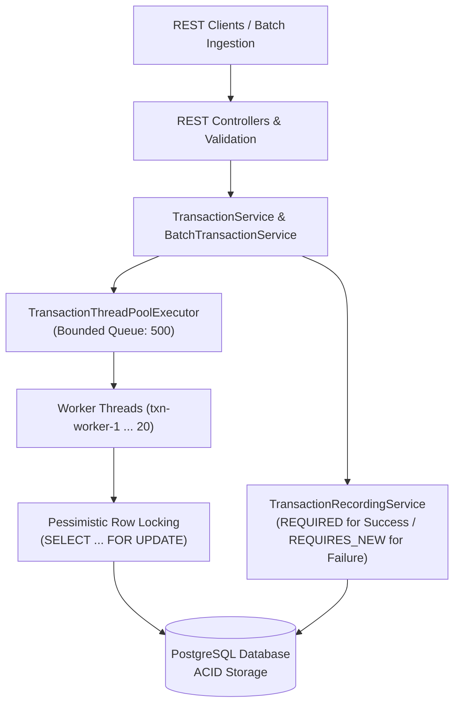
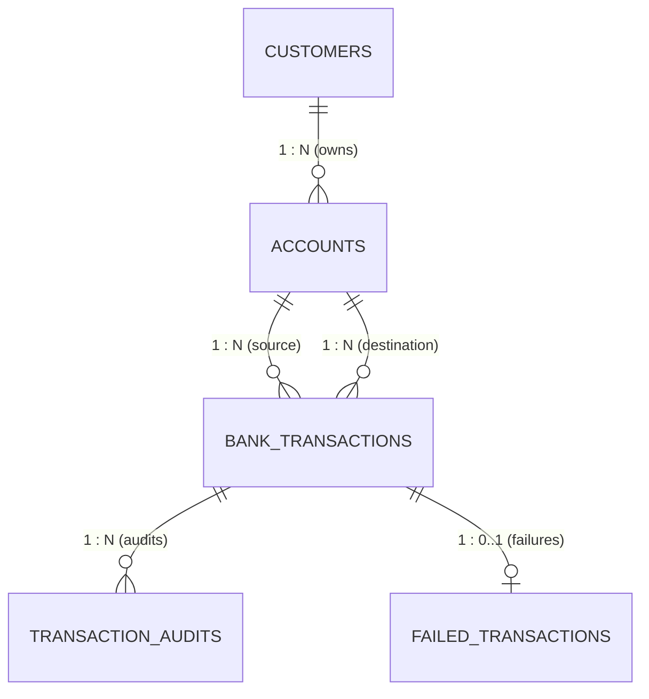

# Multi-Threaded Banking Transaction Processing System

[]()
[]()
[]()
[]()
[]()

A high-throughput, concurrent banking transaction processing engine designed to guarantee ACID transactions, eliminate race conditions, prevent deadlocks, enforce strict financial consistency, and deliver scalable asynchronous batch execution.

---

## 1. Project Title & Professional Introduction

The **Multi-Threaded Banking Transaction Processing System** is an enterprise-grade backend service developed for the Newgen Technical Evaluation. Built with **Spring Boot 4.2**, **Java 17**, and **PostgreSQL**, the system manages customers and accounts while processing deposits, cash withdrawals, and fund transfers concurrently. It features pessimistic row-level locking (`SELECT ... FOR UPDATE`), deterministic deadlock-prevention algorithms, application and database-level idempotency, and a custom bounded `ThreadPoolExecutor` capable of processing 50,000+ simulated transactions.

---

## 2. Business Problem & Project Objectives

### 2.1 The Problem
In financial systems, concurrent transactions targeting the same account lead to catastrophic anomalies without robust synchronization:
- **Lost Updates:** Concurrent deposits overwrite each other, causing discrepancies between account balances and transaction histories.
- **Simultaneous Overdrafts:** Two concurrent withdrawals (e.g. ₹7,000 and ₹5,000 from an account holding ₹10,000) pass separate balance checks simultaneously, driving the balance negative.
- **Deadlocks:** Cross-account transfers (Account A $\to$ B and B $\to$ A) lock accounts in opposite orders, triggering circular-wait deadlocks.
- **Unbounded Queue Heap Exhaustion:** Unchecked thread pools consume infinite memory during load spikes, leading to OutOfMemoryErrors and system crashes.

### 2.2 Project Objectives
1. Guarantee absolute financial precision with Java `BigDecimal` and PostgreSQL `NUMERIC(19, 2)`.
2. Enforce ACID boundaries so that balance updates, transaction records, and audit logs commit atomically.
3. Prevent simultaneous overdrafts and ensure account balances **never** become negative (`balance >= 0`).
4. Prevent transfer deadlocks using a deterministic primary key sorting strategy.
5. Provide fail-fast idempotency to prevent duplicate charges on client retries.
6. Provide a bounded thread pool with back-pressure handling for concurrent batches of up to 1,000 items.
7. Scale to process 50,000+ simulated transactions in controlled batches with verified balance consistency.
8. Provide comprehensive PostgreSQL reporting queries and query plan optimization analyses.

---

## 3. Core Features

- **Customer Management:** Customer registration, unique email constraints, and paginated searches.
- **Account Management:** Auto-generated account numbers (`account_number_seq` prefixed with `NG`), lifecycle status handling (`ACTIVE`, `INACTIVE`, `FROZEN`), and balance queries.
- **Core Banking Operations:**
  - `POST /api/transactions/deposit` — Credited under exclusive pessimistic write lock.
  - `POST /api/transactions/withdraw` — Debited under exclusive pessimistic write lock; prevents overdrafts.
  - `POST /api/transactions/transfer` — Deadlock-safe atomic transfer between distinct accounts.
- **Concurrent Batch Processing:**
  - `POST /api/transactions/batch` — Submits up to 1,000 transactions concurrently via worker threads; returns TPS and per-item results.
- **Two-Tier Idempotency:** Fast in-memory/repository check + database unique constraint on `transaction_id`.
- **Durable Failure Persistence:** Failed/rejected transactions persist categorized failure reasons (`Propagation.REQUIRES_NEW`) even when the outer transaction rolls back.
- **Auditing & Traceability:** Immutable audit trail capturing worker thread names, timestamps, and durations.

---

## 4. Technology Stack

- **Core Language:** Java 17 / 21
- **Framework:** Spring Boot 4.2.0 (Spring MVC, Spring Data JPA, Spring Validation, Actuator)
- **Database:** PostgreSQL (v15+ / v17)
- **Connection Pool:** HikariCP (`maximum-pool-size = 30`, `minimum-idle = 10`)
- **Build & Dependency Management:** Apache Maven 3.9+ via Maven Wrapper (`mvnw` / `mvnw.cmd`)
- **Testing:** JUnit 5, Mockito, Spring WebMVC Test, Spring Data JPA Test
- **Logging:** SLF4J with Logback

---

## 5. System Architecture

The application adopts a clean, layered architecture separating HTTP routing, business logic, asynchronous concurrency execution, and ACID database persistence.

Full architectural details, sequence diagrams, and lifecycle flows are documented in [docs/diagrams/system-architecture.md](docs/diagrams/system-architecture.md).



---

## 6. Database Design & ER Diagram

The database utilizes five normalized tables in PostgreSQL. All monetary columns are typed as `NUMERIC(19, 2)`.

Full table specifications, constraint catalogs, and relationship diagrams are documented in [docs/diagrams/entity-relationship.md](docs/diagrams/entity-relationship.md).



---

## 7. API Documentation Summary

A complete, field-level API specification with request/response schemas, validation rules, and error codes is available in [docs/api-documentation.md](docs/api-documentation.md).

| Method | Endpoint | Description | Status Codes |
|---|---|---|:---:|
| `GET` | `/api/v1/health` | Service health status check | `200` |
| `POST` | `/api/customers` | Register a new customer | `201, 400, 409` |
| `GET` | `/api/customers` | List all customers | `200` |
| `GET` | `/api/customers/paged` | Paginated and sorted customer list | `200, 400` |
| `GET` | `/api/customers/{id}` | Retrieve customer by ID | `200, 404` |
| `POST` | `/api/accounts` | Open savings or current account | `201, 400, 404` |
| `GET` | `/api/accounts/{id}` | Retrieve account details | `200, 404` |
| `GET` | `/api/accounts/customer/{id}` | Retrieve accounts for customer | `200, 404` |
| `POST` | `/api/transactions/deposit` | Deposit funds with row lock | `201, 400, 404, 409` |
| `POST` | `/api/transactions/withdraw` | Withdraw funds with overdraft check | `201, 400, 404, 409, 422` |
| `POST` | `/api/transactions/transfer` | Deadlock-safe fund transfer | `201, 400, 404, 409, 422` |
| `POST` | `/api/transactions/batch` | Concurrent batch execution (up to 1,000) | `200, 400` |
| `GET` | `/api/transactions/{txnId}` | Get transaction details by ID | `200, 404` |
| `GET` | `/api/transactions/account/{id}` | Paginated account transaction history | `200, 404` |

---

## 8. Project Directory Structure

```
banking-transaction-system/
├── backend/
│   ├── src/
│   │   ├── main/java/com/newgen/banking/
│   │   │   ├── controller/         # REST Controllers
│   │   │   ├── dto/                # Request & Response records
│   │   │   ├── entity/             # JPA Entities
│   │   │   ├── exception/          # Custom exceptions & GlobalExceptionHandler
│   │   │   ├── executor/           # TransactionThreadPoolExecutor & Properties
│   │   │   ├── repository/         # Spring Data JPA Repositories
│   │   │   └── service/            # Core business & recording services
│   │   ├── main/resources/
│   │   │   └── application.properties       # Main configuration (banking_db)
│   │   └── test/
│   │       ├── java/com/newgen/banking/
│   │       │   ├── controller/     # MockMvc web slice tests
│   │       │   ├── executor/       # Thread pool unit tests
│   │       │   └── service/        # Service tests, Concurrency tests, Benchmarks
│   │       └── resources/
│   │           └── application-test.properties  # Isolated test config (banking_test_db)
│   ├── pom.xml                     # Maven project descriptor
│   └── mvnw / mvnw.cmd             # Maven Wrapper scripts
├── database/
│   ├── ddl/                        # Schema creation scripts (001, 002, 003, 004)
│   ├── reports/                    # Required SQL reports (01 to 05)
│   └── seed/                       # Sample demonstration seed data
└── docs/
    ├── diagrams/                   # System architecture & ER diagrams
    ├── api-documentation.md        # Complete REST API specification
    ├── concurrency-and-locking-design.md # Locking & deadlock prevention
    ├── idempotency-design.md       # Duplicate transaction protection
    ├── sample-structured-logs.md   # Production logging samples
    ├── sql-performance-analysis.md # Query plans & index justifications
    ├── testing-strategy.md         # Full testing methodology
    ├── thread-pool-design.md       # Bounded executor architecture
    └── transaction-management-design.md # ACID boundaries & propagation
```

---

## 9. Prerequisites & Installation

- **Java Development Kit (JDK):** Version 17 or higher (`java -version`)
- **PostgreSQL Database Server:** Version 15 or higher (`psql --version`)
- **Terminal:** Windows PowerShell or Bash

Verify Java:
```powershell
java -version
```

---

## 10. PostgreSQL Database Setup

Connect to PostgreSQL and create the production and test databases:

```sql
CREATE DATABASE banking_db;
CREATE DATABASE banking_test_db;
```

---

## 11. Environment Variable Configuration

Database credentials are read from environment variables and must **never** be hardcoded:

```powershell
# Windows PowerShell
$env:DB_USERNAME="postgres"
$env:DB_PASSWORD="your_postgres_password"
$env:TEST_DB_USERNAME="postgres"
$env:TEST_DB_PASSWORD="your_postgres_password"
$env:PGPASSWORD="your_postgres_password"
```

---

## 12. DDL Execution

Apply the schema scripts to the database:

```powershell
cd banking-transaction-system

# Apply to banking_db
psql -U postgres -d banking_db -f database/ddl/001_create_customers.sql
psql -U postgres -d banking_db -f database/ddl/002_create_accounts.sql
psql -U postgres -d banking_db -f database/ddl/003_create_transactions.sql
psql -U postgres -d banking_db -f database/ddl/004_performance_indexes.sql

# Apply to banking_test_db
psql -U postgres -d banking_test_db -f database/ddl/001_create_customers.sql
psql -U postgres -d banking_test_db -f database/ddl/002_create_accounts.sql
psql -U postgres -d banking_test_db -f database/ddl/003_create_transactions.sql
psql -U postgres -d banking_test_db -f database/ddl/004_performance_indexes.sql
```

---

## 13. Seed Data Execution

Populate sample customers, accounts, and transactions for demonstration and SQL reporting:

```powershell
psql -U postgres -d banking_test_db -f database/seed/seed_data.sql
```

---

## 14. Application Startup

Run the backend application using the Maven Wrapper:

```powershell
cd backend
.\mvnw.cmd spring-boot:run
```
The server starts on `http://localhost:8080`. Verify health:
```powershell
Invoke-RestMethod -Uri http://localhost:8080/api/v1/health
```

---

## 15. Sample API Requests & Responses

### Open an Account
```powershell
$body = @{ customerId = 1; accountType = "SAVINGS"; initialBalance = 10000.00 } | ConvertTo-Json
Invoke-RestMethod -Method POST -Uri http://localhost:8080/api/accounts -ContentType "application/json" -Body $body
```

### Perform a Transfer
```powershell
$body = @{
    transactionId = "TXN-DEMO-001"
    sourceAccountId = 1
    destinationAccountId = 2
    amount = 1500.00
    description = "Demo transfer"
} | ConvertTo-Json
Invoke-RestMethod -Method POST -Uri http://localhost:8080/api/transactions/transfer -ContentType "application/json" -Body $body
```

---

## 16. Unit Test Execution

Run all 83 unit and MockMvc slice tests (zero database dependency, executes in ~20 seconds):

```powershell
cd backend
.\mvnw.cmd test "-Dtest=BatchTransactionServiceTest,TransactionThreadPoolExecutorTest,BatchTransactionControllerTest,CustomerServiceTest,AccountServiceTest,TransactionServiceTest,CustomerControllerTest,AccountControllerTest,TransactionControllerTest"
```
**Result:** `83 tests run, 0 failures, 0 errors, BUILD SUCCESS`.

---

## 17. Integration Test Execution

Run Spring Boot integration tests against the isolated PostgreSQL `banking_test_db`:

```powershell
$env:TEST_DB_PASSWORD="your_postgres_password"
cd backend
.\mvnw.cmd test "-Dtest=TransactionControllerIntegrationTest,BatchTransactionIntegrationTest"
```

---

## 18. Concurrency Test Execution

Verify pessimistic locking, simultaneous overdraft prevention, and deadlock avoidance under real multi-threaded contention:

```powershell
$env:TEST_DB_PASSWORD="your_postgres_password"
cd backend
.\mvnw.cmd test "-Dtest=TransactionConcurrencyTest"
```
**Verified Scenarios:**
- 10 concurrent deposits $\to$ Zero lost updates.
- ₹7,000 + ₹5,000 concurrent withdrawals from ₹10,000 $\to$ Exactly one succeeds, second fails. Balance never negative.
- Bidirectional transfers ($A \to B$ and $B \to A$) $\to$ Zero deadlocks.

---

## 19. Benchmark Execution

### 19.1 Progressive Worker Benchmarks (200 Transactions)
```powershell
$env:TEST_DB_PASSWORD="your_postgres_password"
cd backend

# 1 Worker
.\mvnw.cmd test "-Dtest=TransactionBenchmarkTest#benchmark_1Worker_200Transfers"
# 5 Workers
.\mvnw.cmd test "-Dtest=TransactionBenchmarkTest#benchmark_5Workers_200Transfers"
# 10 Workers
.\mvnw.cmd test "-Dtest=TransactionBenchmarkTest#benchmark_10Workers_200Transfers"
# 20 Workers
.\mvnw.cmd test "-Dtest=TransactionBenchmarkTest#benchmark_20Workers_200Transfers"
```

### 19.2 50,000+ Transaction Stress Benchmark
Submits 50,000 mixed transactions in 100 chunked batches of 500 across 10 active accounts:
```powershell
$env:TEST_DB_PASSWORD="your_postgres_password"
cd backend
.\mvnw.cmd test "-Dtest=StressBenchmark50kTest#benchmark50k_10Workers"
```

---

## 20. SQL Report Execution

Execute the five required assignment reports against PostgreSQL:

```powershell
$env:PGPASSWORD="your_postgres_password"
cd banking-transaction-system

# 1. Top 10 accounts by volume
psql -U postgres -d banking_test_db -f database/reports/01_top_10_accounts_by_volume.sql

# 2. Failed transactions grouped by reason
psql -U postgres -d banking_test_db -f database/reports/02_failed_transactions_by_reason.sql

# 3. Daily transaction amount by type
psql -U postgres -d banking_test_db -f database/reports/03_daily_transaction_amount_by_type.sql

# 4. Accounts with more than N transactions
psql -U postgres -d banking_test_db -v min_tx_count=2 -f database/reports/04_accounts_with_more_than_n_transactions.sql

# 5. Customer transaction history
psql -U postgres -d banking_test_db -v customer_id=1 -f database/reports/05_customer_transaction_history.sql
```

---

## 21. Performance Analysis & Query Optimization

Documented in [docs/sql-performance-analysis.md](docs/sql-performance-analysis.md):
- **Transaction Hot Path (`existsByTransactionId`):** Operates via `Index Only Scan` on `uk_bank_transactions_transaction_id` in $O(\log N)$ time.
- **Daily Volume Aggregation:** Added covering composite index `idx_bank_transactions_status_created_type` with `INCLUDE (amount)` in `004_performance_indexes.sql`, converting full heap sequential scans into fast `Index Only Scan`s.

---

## 22. Logging & Exception Handling

- **Structured Logging:** Detailed samples in [docs/sample-structured-logs.md](docs/sample-structured-logs.md). Emits thread names, transaction IDs, account numbers, amounts, and durations.
- **Centralized Handling:** `GlobalExceptionHandler` maps domain exceptions to standard RFC-compliant HTTP status codes (`400`, `404`, `409`, `422`, `500`).

---

## 23. Design Decisions & Trade-Offs

1. **Pessimistic vs. Optimistic Locking:**
   - *Decision:* Pessimistic write locking (`SELECT ... FOR UPDATE`).
   - *Trade-off:* Slightly longer lock hold times under contention in exchange for zero rollback-retry storms and deterministic serial execution.
2. **Deterministic Primary Key Lock Ordering:**
   - *Decision:* Order accounts by $\min(\text{ID})$ and $\max(\text{ID})$ before requesting locks.
   - *Trade-off:* Minimal sorting overhead in Java ($\sim 1 \mu s$) to completely eliminate circular-wait database deadlocks.
3. **Propagation Scope Split (`REQUIRED` vs `REQUIRES_NEW`):**
   - *Decision:* Use `REQUIRED` for success (atomic commit on 1 connection) and `REQUIRES_NEW` for failure logging.
   - *Trade-off:* Keeps failure audits permanent while preventing Hikari connection pool exhaustion.
4. **Bounded Queue Chunking:**
   - *Decision:* Process 50,000 transactions in bounded batches of 500 items.
   - *Trade-off:* Requires chunking loops on the client/test harness, but guarantees zero JVM heap exhaustion.

---

## 24. Known Limitations

1. **Single-Node Database:** Locking is enforced by PostgreSQL row-level locks. For a multi-region active-active distributed database, distributed consensus (e.g. Raft/Spanner) or two-phase commit (2PC) would be required.
2. **Web Frontend:** The backend provides complete, fully tested REST APIs. The React frontend referenced in early architecture specifications remains a separate decoupled client interface.
