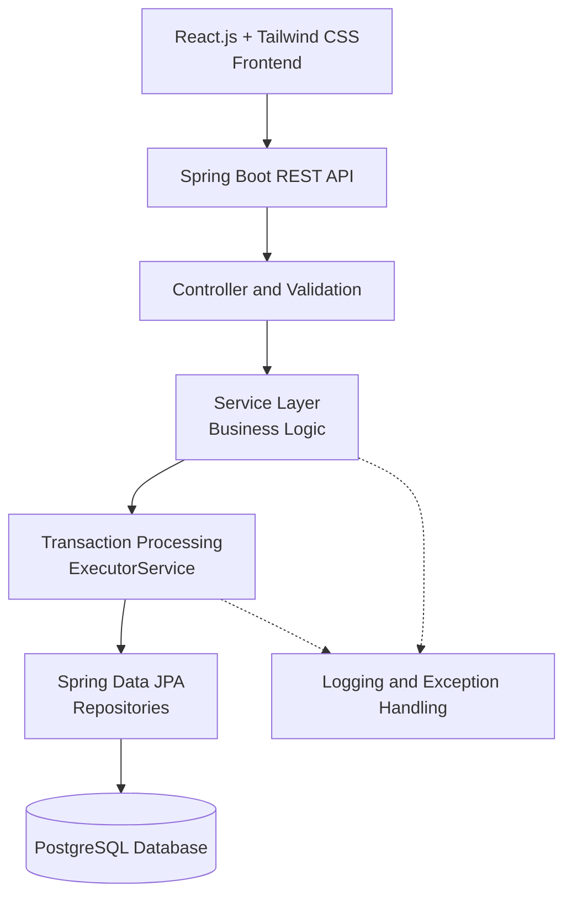

# System Architecture

## 1. Overview

The Banking Transaction Processing System will follow a layered architecture. The frontend, backend and database will have separate responsibilities.

React will be used to build the user interface, Spring Boot will handle the backend operations, and PostgreSQL will store customer, account and transaction data.

The application will also include a transaction processing component to handle multiple requests safely.

## 2. Main Components

### 2.1 Frontend

The frontend will be developed using React.js and Tailwind CSS.

It will provide an interface for performing banking operations and viewing account and transaction details.

Main responsibilities:

- Display customer and account information.
- Submit deposit and withdrawal requests.
- Submit fund transfer requests.
- Display account balances.
- Show transaction history and processing status.
- Display validation errors and transaction results.

### 2.2 Backend

Spring Boot will be used to develop the REST APIs and handle the application's business logic.

The backend will contain the following layers:

- **Controller:** Receives API requests and sends responses.
- **Service:** Handles banking operations and business rules.
- **Repository:** Communicates with the PostgreSQL database.
- **Entity:** Represents the database tables.
- **DTO:** Defines the data exchanged between the frontend and backend.
- **Exception:** Handles application errors and invalid operations.

### 2.3 Transaction Processing

The transaction processing component will handle deposit, withdrawal and transfer requests.

A bounded thread pool using Java ExecutorService will be used for processing multiple simulated transactions.

Database transactions and appropriate locking will be used to maintain correct account balances when multiple operations access the same account.

### 2.4 Database

PostgreSQL will be used to store the application's data.

The main tables will be:

- CUSTOMER
- ACCOUNT
- TRANSACTION
- TRANSACTION_AUDIT
- FAILED_TRANSACTION

The database will use primary keys, foreign keys, constraints and indexes to maintain data consistency.

### 2.5 Logging and Exception Handling

SLF4J and Logback will be used to record application events.

The logs will help track transaction processing, identify failures and understand application behaviour.

Custom exceptions will be used to handle common errors such as insufficient balance, invalid accounts and duplicate transaction requests.

## 3. Request Flow

The application will follow this flow when a user performs a banking operation:

1. The user submits a request through the React frontend.
2. The request is sent to the Spring Boot REST API.
3. The controller receives the request and validates the input.
4. The service layer checks the business rules.
5. The repository interacts with PostgreSQL.
6. The database transaction updates the required records.
7. The backend returns the processing result to the frontend.
8. The application records relevant logs and audit information.

## 4. Concurrent Processing Flow

For simulated transaction processing, multiple tasks will be submitted to a bounded thread pool.

Each task will process its transaction using the backend service layer.

The database will handle transaction boundaries and locking to prevent incorrect balance updates.

The system will also check transaction IDs to prevent duplicate processing.

## 5. Design Considerations

The following points will be considered during development:

- Keep frontend, backend and database responsibilities separate.
- Maintain account balance consistency.
- Prevent duplicate transaction processing.
- Avoid negative account balances.
- Handle failed transactions with proper error information.
- Keep transaction processing and database operations testable.
- Record enough information to investigate transaction failures.

## 6. Expected Architecture

The architecture is planned to support reliable banking operations, concurrent transaction processing and future improvements without mixing all application logic into a single component.

