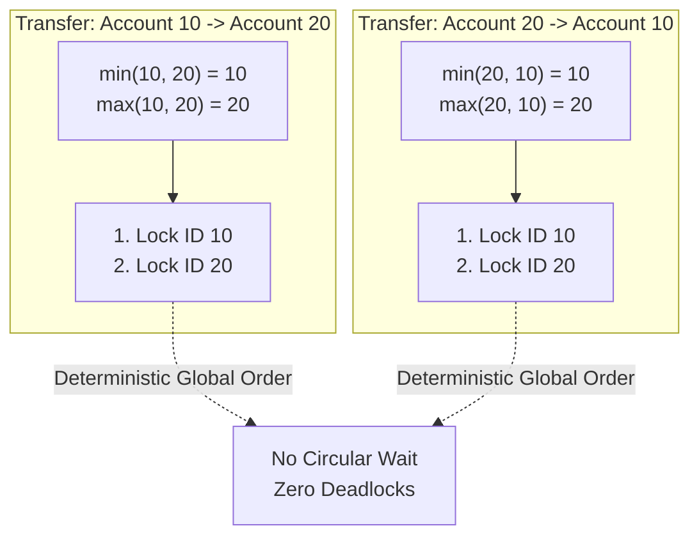

# Concurrency Control & Database Locking Design

## 1. Overview

In high-concurrency banking environments, multiple requests frequently attempt to mutate the same account simultaneously. This document details our concurrency control architecture, explains how pessimistic write locking (`SELECT ... FOR UPDATE`) prevents lost updates and overdrafts, demonstrates our deadlock-prevention strategy, and provides empirical test evidence.

---

## 2. Race Conditions in Banking Systems

| Race Condition | Manifestation Without Locking | Impact |
|---|---|---|
| **Lost Updates** | Two concurrent deposits of ₹500 read initial balance ₹1,000. Both write ₹1,500. | ₹500 is lost from the customer's balance. |
| **Simultaneous Overdraft** | Account has ₹10,000. Two concurrent withdrawals of ₹7,000 and ₹5,000 read ₹10,000. Both pass balance checks and commit. | Final balance becomes -₹2,000. |
| **Circular-Wait Deadlock** | Transfer 1 moves funds from Account A to B; Transfer 2 moves funds from B to A simultaneously. | Both threads block indefinitely holding one lock while awaiting the other. |
| **Phantom Reads** | A balance check passes, but another thread withdraws before the debit executes. | Inconsistent financial state. |

---

## 3. Pessimistic Write Locking (`SELECT ... FOR UPDATE`)

### 3.1 Mechanism
We chose **Pessimistic Write Locking** (`LockModeType.PESSIMISTIC_WRITE`) over Optimistic Locking (`@Version`):
- **Why not Optimistic Locking?** Optimistic locking detects collisions at commit time and throws `OptimisticLockException`. Under high concurrent load (e.g. batch payroll or flash sales), high collision rates cause frequent rollbacks and retries, wasting CPU and DB resources.
- **Pessimistic Locking:** Serializes access at the database row level. Incoming requests for the same row queue up cleanly and execute in serial order without rollbacks.

### 3.2 Implementation in `AccountRepository`
*Source: `backend/src/main/java/com/newgen/banking/repository/AccountRepository.java`*

```java
@Lock(LockModeType.PESSIMISTIC_WRITE)
@Query("SELECT a FROM Account a WHERE a.id = :id")
Optional<Account> findByIdForUpdate(@Param("id") Long id);

@Lock(LockModeType.PESSIMISTIC_WRITE)
@Query("SELECT a FROM Account a WHERE a.id IN :ids ORDER BY a.id ASC")
List<Account> findByIdsForUpdate(@Param("ids") List<Long> ids);
```

> [!IMPORTANT]
> **No Outer Joins with Pessimistic Locking:** In PostgreSQL, executing `FOR UPDATE` on queries with a `LEFT OUTER JOIN` results in:
> `ERROR: FOR UPDATE cannot be applied to the nullable side of an outer join`.
> Therefore, `@EntityGraph` is intentionally omitted from `findByIdForUpdate` and `findByIdsForUpdate`, ensuring clean, single-table row locks on `accounts`.

---

## 4. Deadlock Prevention via Deterministic Lock Ordering

### 4.1 The Deadlock Problem
If two threads transfer between Account 10 and Account 20 in opposite directions:
- Thread 1 (10 $\to$ 20) locks 10, requests 20.
- Thread 2 (20 $\to$ 10) locks 20, requests 10.
- **Result:** Classical Coffman circular-wait condition $\to$ PostgreSQL deadlock detected.

### 4.2 The Sorted Lock Solution
In [TransactionService.java](file:///c:/Users/XPS/Documents/Newgen-Project/banking-transaction-system/backend/src/main/java/com/newgen/banking/service/TransactionService.java#L208-L215), lock acquisition order is strictly sorted by ascending primary key ID:

```java
List<Long> orderedIds = new ArrayList<>(List.of(
        Math.min(request.sourceAccountId(), request.destinationAccountId()),
        Math.max(request.sourceAccountId(), request.destinationAccountId())
));
List<Account> lockedAccounts = accountRepository.findByIdsForUpdate(orderedIds);
```

Regardless of transfer direction (A $\to$ B or B $\to$ A), both threads always acquire the lock on $\min(\text{ID}_A, \text{ID}_B)$ first, and then $\max(\text{ID}_A, \text{ID}_B)$. This breaks the circular wait condition and makes deadlocks mathematically impossible.



---

## 5. Automated Concurrency Test Evidence

Our test suite in [TransactionConcurrencyTest.java](file:///c:/Users/XPS/Documents/Newgen-Project/banking-transaction-system/backend/src/test/java/com/newgen/banking/service/TransactionConcurrencyTest.java) executes 9 automated multi-threaded tests against PostgreSQL:

1. **10 Concurrent Deposits (`concurrentDeposits_ShouldAllSucceedAndBalanceIsAccurate`):**
   - 10 threads deposit ₹100.00 simultaneously into an account with ₹1,000.00.
   - Result: Exactly ₹2,000.00 final balance. Zero lost updates.
2. **Simultaneous Overdraft (`concurrentWithdrawals_ExceedingBalance_OnlyOneSucceeds`):**
   - Account starts with ₹10,000.00.
   - Two concurrent threads attempt withdrawals of ₹7,000.00 and ₹5,000.00 ($7,000 + 5,000 = 12,000 > 10,000$).
   - Result: Exactly one withdrawal succeeds (balance ₹3,000.00 or ₹5,000.00), the second fails with `InsufficientBalanceException`. Never negative.
3. **Bidirectional Transfers (`oppositeDirectionTransfers_ShouldCompleteWithoutDeadlock`):**
   - Two accounts start with ₹1,000.00 each.
   - Simultaneous opposite transfers ($A \to B$ and $B \to A$) execute concurrently.
   - Result: Completes with 0 deadlocks. Total money in system conserved ($\sum = \text{₹}2,000.00$).
