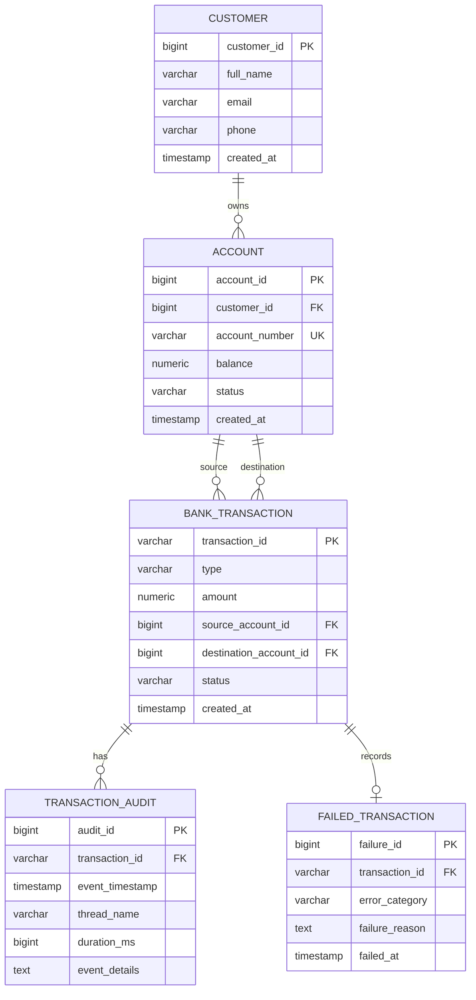

# Database Design

## 1. Introduction

PostgreSQL will be used to store customer details, account information and transaction records.

The database is divided into five main tables. Each table will have a specific responsibility so that data can be maintained properly and unnecessary duplication can be avoided.

## 2. Tables and Their Responsibilities

### 2.1 CUSTOMER

This table will store basic customer information.

| Column | Description |
|---|---|
| customer_id | Primary key |
| full_name | Customer name |
| email | Customer email |
| phone | Contact number |
| created_at | Record creation time |

### 2.2 ACCOUNT

This table will store bank account details and current balances.

| Column | Description |
|---|---|
| account_id | Primary key |
| customer_id | Foreign key referencing CUSTOMER |
| account_number | Unique account number |
| balance | Current account balance |
| status | Account status |
| created_at | Account creation time |

### 2.3 TRANSACTION

The actual PostgreSQL table will be named `bank_transaction` to avoid using a SQL keyword as a table name.

It will store details of deposits, withdrawals and fund transfers.

| Column | Description |
|---|---|
| transaction_id | Unique transaction identifier |
| type | DEPOSIT, WITHDRAWAL or TRANSFER |
| amount | Transaction amount |
| source_account_id | Source account reference |
| destination_account_id | Destination account reference |
| status | SUCCESS, FAILED or REJECTED |
| created_at | Transaction creation time |

### 2.4 TRANSACTION_AUDIT

This table will maintain information about transaction processing activities.

| Column | Description |
|---|---|
| audit_id | Primary key |
| transaction_id | Foreign key referencing bank_transaction |
| event_timestamp | Time of the audit event |
| thread_name | Thread that processed the transaction |
| duration_ms | Processing duration |
| event_details | Details of the processing event |

### 2.5 FAILED_TRANSACTION

This table will store additional information about transactions that could not be completed.

| Column | Description |
|---|---|
| failure_id | Primary key |
| transaction_id | Foreign key referencing bank_transaction |
| error_category | Category of the error |
| failure_reason | Reason for the failure |
| failed_at | Time of failure |

## 3. Table Relationships

- One customer can have multiple accounts.
- One account can be involved in multiple transactions.
- A transaction can have multiple audit records.
- A transaction can have one associated failure record.

## 4. Data Integrity

The following database constraints will be considered:

- Primary keys will uniquely identify each record.
- Foreign keys will maintain relationships between tables.
- Account numbers and transaction IDs will be unique.
- Transaction amounts must be greater than zero.
- Account balances must not become negative.
- Required fields will not accept NULL values.
- Account and transaction statuses will be restricted to valid values.

## 5. Monetary Data

The PostgreSQL `NUMERIC(19,2)` data type will be used for account balances and transaction amounts.

Java `BigDecimal` will be used for monetary calculations to avoid floating-point precision issues.

## 6. Indexing

Indexes will be considered for columns frequently used in searches, joins and reports.

The final index choices will be made after reviewing the important SQL queries and their execution plans.

## 7. ER Diagram

The following diagram shows the planned relationships between the five main tables.

