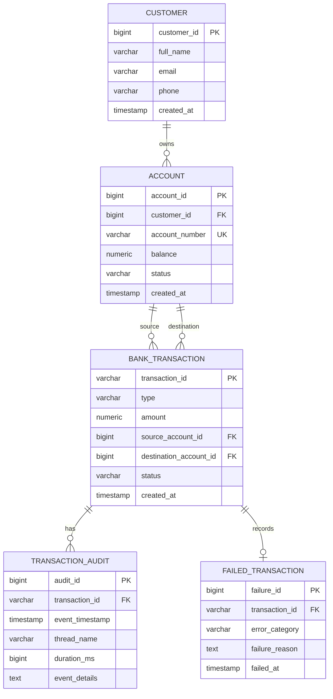

# Database Design

## 1. Introduction

PostgreSQL will be used to store customer details, account information and transaction records.

The database is divided into five main tables. Each table will have a specific responsibility so that data can be maintained properly and unnecessary duplication can be avoided.

## 2. Tables and Their Responsibilities

### 2.1 `customers` (Implemented — `001_create_customers.sql`)

Stores basic customer information.

| Column | Type / Constraints | Description |
|---|---|---|
| `id` | `BIGINT GENERATED BY DEFAULT AS IDENTITY PRIMARY KEY` | Primary key |
| `full_name` | `VARCHAR(100) NOT NULL` | Customer name (indexed via `idx_customers_full_name`) |
| `email` | `VARCHAR(150) NOT NULL UNIQUE` | Unique customer email |
| `phone` | `VARCHAR(15)` | Optional contact number |
| `created_at` | `TIMESTAMP NOT NULL DEFAULT CURRENT_TIMESTAMP` | Record creation time |

### 2.2 `accounts` (Implemented — `002_create_accounts.sql`)

Stores bank account details, ownership, and current balances. Account numbers are generated from PostgreSQL sequence `account_number_seq` (starting at `1000000001`, prefixed with `NG`).

| Column | Type / Constraints | Description |
|---|---|---|
| `id` | `BIGINT GENERATED BY DEFAULT AS IDENTITY PRIMARY KEY` | Primary key |
| `account_number` | `VARCHAR(20) NOT NULL UNIQUE` (`uk_accounts_account_number`) | Unique generated account number |
| `customer_id` | `BIGINT NOT NULL` (`fk_accounts_customer` -> `customers(id) ON DELETE RESTRICT`) | Owning customer (indexed via `idx_accounts_customer_id`) |
| `account_type` | `VARCHAR(20) NOT NULL` (`CHECK` in `'SAVINGS'`, `'CURRENT'`) | Account type |
| `balance` | `NUMERIC(19,2) NOT NULL DEFAULT 0.00` (`CHECK (balance >= 0)`) | Current non-negative account balance |
| `status` | `VARCHAR(20) NOT NULL DEFAULT 'ACTIVE'` (`CHECK` in `'ACTIVE'`, `'INACTIVE'`, `'FROZEN'`) | Account status (indexed via `idx_accounts_status`) |
| `created_at` | `TIMESTAMP NOT NULL DEFAULT CURRENT_TIMESTAMP` | Account creation time |
| `updated_at` | `TIMESTAMP NOT NULL DEFAULT CURRENT_TIMESTAMP` | Last update time |

### 2.3 `bank_transactions` (Implemented — `003_create_transactions.sql`)

Named `bank_transactions` to avoid using the SQL reserved keyword `transaction`. Stores deposits, withdrawals, and fund transfers along with a unique `transaction_id` idempotency key.

| Column | Type / Constraints | Description |
|---|---|---|
| `id` | `BIGINT GENERATED BY DEFAULT AS IDENTITY PRIMARY KEY` | Surrogate primary key |
| `transaction_id` | `VARCHAR(64) NOT NULL UNIQUE` (`uk_bank_transactions_transaction_id`) | Unique transaction / idempotency ID |
| `transaction_type` | `VARCHAR(20) NOT NULL` (`CHECK` in `'DEPOSIT'`, `'WITHDRAWAL'`, `'TRANSFER'`) | Operation type |
| `amount` | `NUMERIC(19,2) NOT NULL` (`CHECK (amount > 0)`) | Positive transaction amount |
| `source_account_id` | `BIGINT` (`fk_bank_transactions_source_account` -> `accounts(id) ON DELETE RESTRICT`) | Source account (null for `DEPOSIT`) |
| `destination_account_id` | `BIGINT` (`fk_bank_transactions_dest_account` -> `accounts(id) ON DELETE RESTRICT`) | Destination account (null for `WITHDRAWAL`) |
| `status` | `VARCHAR(20) NOT NULL` (`CHECK` in `'SUCCESS'`, `'FAILED'`, `'REJECTED'`) | Processing outcome |
| `description` | `VARCHAR(255)` | Optional transaction note |
| `failure_reason` | `VARCHAR(500)` | Failure/rejection reason when applicable |
| `created_at` | `TIMESTAMP NOT NULL DEFAULT CURRENT_TIMESTAMP` | Transaction timestamp |

Additional database integrity constraints and indexes:
- `chk_bank_transactions_distinct_accounts`: ensures `source_account_id <> destination_account_id` when both are non-null.
- Indexes on `source_account_id`, `destination_account_id`, `status`, and `created_at`.

### 2.4 `transaction_audits` (Implemented — `003_create_transactions.sql`)

Captures execution metadata (thread name, duration in milliseconds, status, details) for each transaction attempt.

| Column | Type / Constraints | Description |
|---|---|---|
| `id` | `BIGINT GENERATED BY DEFAULT AS IDENTITY PRIMARY KEY` | Primary key |
| `bank_transaction_id` | `BIGINT NOT NULL` (`fk_transaction_audits_tx` -> `bank_transactions(id) ON DELETE CASCADE`) | Referenced transaction |
| `transaction_id` | `VARCHAR(64) NOT NULL` | Business transaction identifier |
| `event_timestamp` | `TIMESTAMP NOT NULL DEFAULT CURRENT_TIMESTAMP` | Audit timestamp |
| `thread_name` | `VARCHAR(100) NOT NULL` | Executing thread name |
| `duration_ms` | `BIGINT NOT NULL DEFAULT 0` (`CHECK (duration_ms >= 0)`) | Processing duration in ms |
| `event_status` | `VARCHAR(20) NOT NULL` (`CHECK` in `'SUCCESS'`, `'FAILED'`, `'REJECTED'`) | Outcome status |
| `event_details` | `VARCHAR(500)` | Event summary |

### 2.5 `failed_transactions` (Implemented — `003_create_transactions.sql`)

Stores categorized failure details (`INSUFFICIENT_BALANCE`, `INACTIVE_ACCOUNT`, `ACCOUNT_NOT_FOUND`) for `FAILED` and `REJECTED` transactions.

| Column | Type / Constraints | Description |
|---|---|---|
| `id` | `BIGINT GENERATED BY DEFAULT AS IDENTITY PRIMARY KEY` | Primary key |
| `bank_transaction_id` | `BIGINT NOT NULL UNIQUE` (`uk_failed_transactions_bank_tx`, FK -> `bank_transactions(id) ON DELETE CASCADE`) | Referenced transaction (1:1 for failed/rejected) |
| `transaction_id` | `VARCHAR(64) NOT NULL` | Business transaction identifier |
| `error_category` | `VARCHAR(100) NOT NULL` | Categorized failure code |
| `failure_reason` | `VARCHAR(500) NOT NULL` | Detailed failure reason |
| `failed_at` | `TIMESTAMP NOT NULL DEFAULT CURRENT_TIMESTAMP` | Failure timestamp |

## 3. Table Relationships

- One customer can have multiple accounts.
- One account can be involved in multiple transactions.
- A transaction can have multiple audit records.
- A transaction can have one associated failure record.

## 4. Data Integrity

The following database constraints will be considered:

- Primary keys will uniquely identify each record.
- Foreign keys will maintain relationships between tables.
- Account numbers and transaction IDs will be unique.
- Transaction amounts must be greater than zero.
- Account balances must not become negative.
- Required fields will not accept NULL values.
- Account and transaction statuses will be restricted to valid values.

## 5. Monetary Data

The PostgreSQL `NUMERIC(19,2)` data type will be used for account balances and transaction amounts.

Java `BigDecimal` will be used for monetary calculations to avoid floating-point precision issues.

## 6. Indexing

Indexes will be considered for columns frequently used in searches, joins and reports.

The final index choices will be made after reviewing the important SQL queries and their execution plans.

## 7. ER Diagram

The following diagram shows the planned relationships between the five main tables.

## 7. Concurrency and Locking Notes

Balance columns in the `accounts` table are protected by **pessimistic write locks**
(`SELECT … FOR UPDATE`) during every deposit, withdrawal, and transfer operation.

- The application issues `findByIdForUpdate` (single account) or `findByIdsForUpdate`
  (transfer — ordered by `id ASC`) to acquire the row-level lock before reading
  or modifying the balance.
- Locks are held for the duration of the enclosing `@Transactional` method and
  released on commit or rollback.
- Transfer operations always lock the lower account ID first, then the higher ID,
  preventing circular-wait deadlocks.

See [`docs/concurrency-design.md`](concurrency-design.md) for the full design
rationale, flow diagrams, and test coverage.
