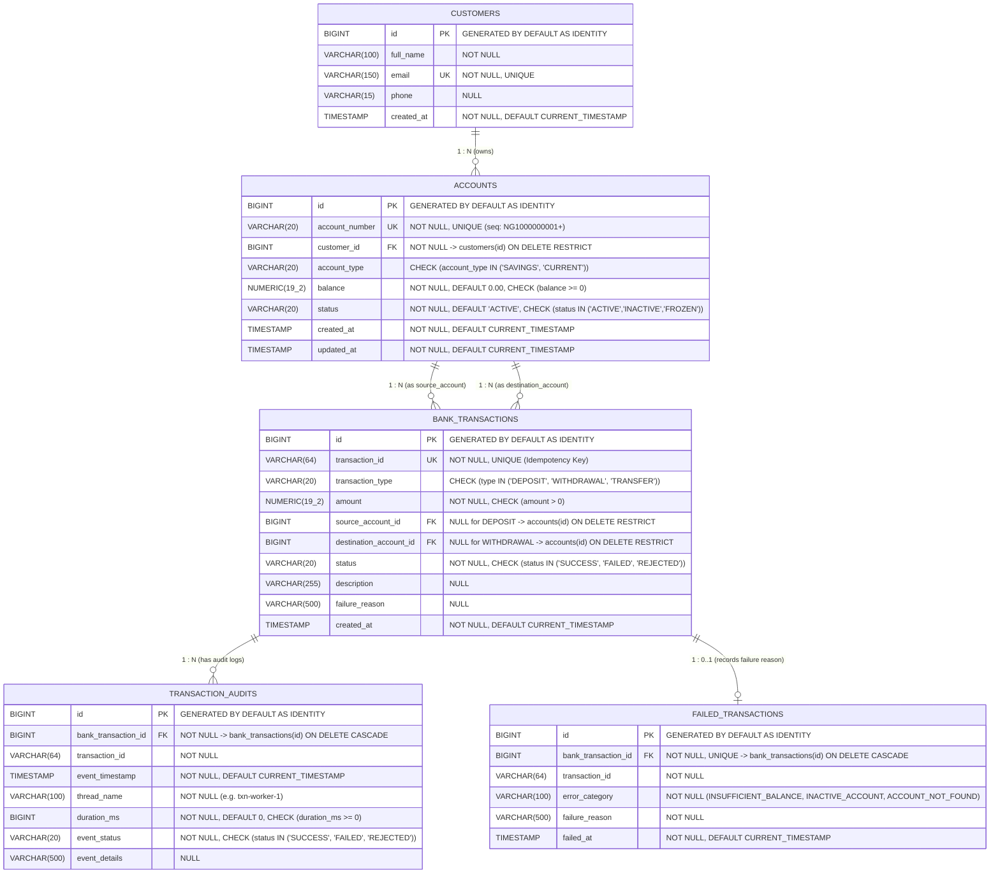

# Database Entity-Relationship (ER) Diagram

## 1. Overview

The database design for the **Banking Transaction Processing System** is implemented in PostgreSQL and mapped using Spring Data JPA. It enforces data integrity, ACID consistency, and historical auditability through foreign key constraints, unique constraints, check constraints, and performance indexes.

---

## 2. Entity-Relationship Diagram

---

## 3. Table Catalog & Constraint Specifications

### 3.1 `customers`
*DDL Source: `database/ddl/001_create_customers.sql`*

| Column | Data Type | Constraints | Description |
|---|---|---|---|
| `id` | `BIGINT` | `PRIMARY KEY GENERATED BY DEFAULT AS IDENTITY` | Surrogate primary key. |
| `full_name` | `VARCHAR(100)` | `NOT NULL` | Customer legal full name. |
| `email` | `VARCHAR(150)` | `NOT NULL, UNIQUE (customers_email_key)` | Unique customer email address. |
| `phone` | `VARCHAR(15)` | `NULL` | Optional contact telephone number. |
| `created_at` | `TIMESTAMP` | `NOT NULL DEFAULT CURRENT_TIMESTAMP` | System creation timestamp. |

**Indexes:**
- `customers_pkey` on `(id)`
- `customers_email_key` on `(email)` (Unique)
- `idx_customers_full_name` on `(full_name)`

---

### 3.2 `accounts`
*DDL Source: `database/ddl/002_create_accounts.sql`*

| Column | Data Type | Constraints | Description |
|---|---|---|---|
| `id` | `BIGINT` | `PRIMARY KEY GENERATED BY DEFAULT AS IDENTITY` | Account surrogate identifier (used for row locking). |
| `account_number` | `VARCHAR(20)` | `NOT NULL, UNIQUE (uk_accounts_account_number)` | Business account number (`NG1000000001`+). |
| `customer_id` | `BIGINT` | `NOT NULL, FK -> customers(id) ON DELETE RESTRICT` | Foreign key referencing account owner. |
| `account_type` | `VARCHAR(20)` | `NOT NULL, CHECK (account_type IN ('SAVINGS', 'CURRENT'))` | Supported account classification. |
| `balance` | `NUMERIC(19, 2)` | `NOT NULL DEFAULT 0.00, CHECK (balance >= 0)` | High-precision monetary balance (never negative). |
| `status` | `VARCHAR(20)` | `NOT NULL DEFAULT 'ACTIVE', CHECK (status IN ('ACTIVE', 'INACTIVE', 'FROZEN'))` | Current lifecycle state. |
| `created_at` | `TIMESTAMP` | `NOT NULL DEFAULT CURRENT_TIMESTAMP` | Account opening timestamp. |
| `updated_at` | `TIMESTAMP` | `NOT NULL DEFAULT CURRENT_TIMESTAMP` | Last balance mutation timestamp. |

**Indexes:**
- `accounts_pkey` on `(id)`
- `uk_accounts_account_number` on `(account_number)` (Unique)
- `idx_accounts_customer_id` on `(customer_id)`
- `idx_accounts_status` on `(status)`

---

### 3.3 `bank_transactions`
*DDL Source: `database/ddl/003_create_transactions.sql`*

| Column | Data Type | Constraints | Description |
|---|---|---|---|
| `id` | `BIGINT` | `PRIMARY KEY GENERATED BY DEFAULT AS IDENTITY` | Transaction internal record ID. |
| `transaction_id` | `VARCHAR(64)` | `NOT NULL, UNIQUE (uk_bank_transactions_transaction_id)` | Client/system idempotency key. |
| `transaction_type` | `VARCHAR(20)` | `NOT NULL, CHECK (type IN ('DEPOSIT', 'WITHDRAWAL', 'TRANSFER'))` | Financial operation type. |
| `amount` | `NUMERIC(19, 2)` | `NOT NULL, CHECK (amount > 0)` | Strictly positive transaction value. |
| `source_account_id` | `BIGINT` | `NULL, FK -> accounts(id) ON DELETE RESTRICT` | Debited account (`NULL` for `DEPOSIT`). |
| `destination_account_id` | `BIGINT` | `NULL, FK -> accounts(id) ON DELETE RESTRICT` | Credited account (`NULL` for `WITHDRAWAL`). |
| `status` | `VARCHAR(20)` | `NOT NULL, CHECK (status IN ('SUCCESS', 'FAILED', 'REJECTED'))` | Outcome status. |
| `description` | `VARCHAR(255)` | `NULL` | Transaction narrative or description. |
| `failure_reason` | `VARCHAR(500)` | `NULL` | Detailed reason if failed or rejected. |
| `created_at` | `TIMESTAMP` | `NOT NULL DEFAULT CURRENT_TIMESTAMP` | Submission timestamp. |

**Integrity Checks:**
- `chk_bank_transactions_distinct_accounts`: `source_account_id IS NULL OR destination_account_id IS NULL OR source_account_id <> destination_account_id`. Prevents transferring funds from an account to itself.

**Indexes:**
- `bank_transactions_pkey` on `(id)`
- `uk_bank_transactions_transaction_id` on `(transaction_id)` (Unique)
- `idx_bank_transactions_source_account_id` on `(source_account_id)`
- `idx_bank_transactions_dest_account_id` on `(destination_account_id)`
- `idx_bank_transactions_status` on `(status)`
- `idx_bank_transactions_created_at` on `(created_at)`
- `idx_bank_transactions_status_created_type` on `(status, created_at, transaction_type) INCLUDE (amount)` (from `004_performance_indexes.sql`)

---

### 3.4 `transaction_audits`
*DDL Source: `database/ddl/003_create_transactions.sql`*

| Column | Data Type | Constraints | Description |
|---|---|---|---|
| `id` | `BIGINT` | `PRIMARY KEY GENERATED BY DEFAULT AS IDENTITY` | Audit log surrogate key. |
| `bank_transaction_id` | `BIGINT` | `NOT NULL, FK -> bank_transactions(id) ON DELETE CASCADE` | Parent transaction reference. |
| `transaction_id` | `VARCHAR(64)` | `NOT NULL` | Redundant business identifier for fast audit indexing. |
| `event_timestamp` | `TIMESTAMP` | `NOT NULL DEFAULT CURRENT_TIMESTAMP` | Exact time audit log was written. |
| `thread_name` | `VARCHAR(100)` | `NOT NULL` | Worker thread name (e.g. `txn-worker-1`). |
| `duration_ms` | `BIGINT` | `NOT NULL DEFAULT 0, CHECK (duration_ms >= 0)` | Processing execution duration in milliseconds. |
| `event_status` | `VARCHAR(20)` | `NOT NULL, CHECK (status IN ('SUCCESS', 'FAILED', 'REJECTED'))` | Execution status. |
| `event_details` | `VARCHAR(500)` | `NULL` | Narrative execution summary. |

**Indexes:**
- `transaction_audits_pkey` on `(id)`
- `idx_transaction_audits_bank_tx_id` on `(bank_transaction_id)`
- `idx_transaction_audits_transaction_id` on `(transaction_id)`
- `idx_transaction_audits_event_timestamp` on `(event_timestamp)`

---

### 3.5 `failed_transactions`
*DDL Source: `database/ddl/003_create_transactions.sql`*

| Column | Data Type | Constraints | Description |
|---|---|---|---|
| `id` | `BIGINT` | `PRIMARY KEY GENERATED BY DEFAULT AS IDENTITY` | Primary key. |
| `bank_transaction_id` | `BIGINT` | `NOT NULL, UNIQUE (uk_failed_transactions_bank_tx), FK -> bank_transactions(id) ON DELETE CASCADE` | 1:1 link to failed `bank_transactions` record. |
| `transaction_id` | `VARCHAR(64)` | `NOT NULL` | Business transaction ID. |
| `error_category` | `VARCHAR(100)` | `NOT NULL` | Categorized error code (`INSUFFICIENT_BALANCE`, `INACTIVE_ACCOUNT`, `ACCOUNT_NOT_FOUND`). |
| `failure_reason` | `VARCHAR(500)` | `NOT NULL` | Human-readable explanation. |
| `failed_at` | `TIMESTAMP` | `NOT NULL DEFAULT CURRENT_TIMESTAMP` | Failure occurrence timestamp. |

**Indexes:**
- `failed_transactions_pkey` on `(id)`
- `uk_failed_transactions_bank_tx` on `(bank_transaction_id)` (Unique)
- `idx_failed_transactions_transaction_id` on `(transaction_id)`
- `idx_failed_transactions_error_category` on `(error_category)`
- `idx_failed_transactions_failed_at` on `(failed_at)`
- `idx_failed_transactions_category_reason` on `(error_category, failure_reason)` (from `004_performance_indexes.sql`)
