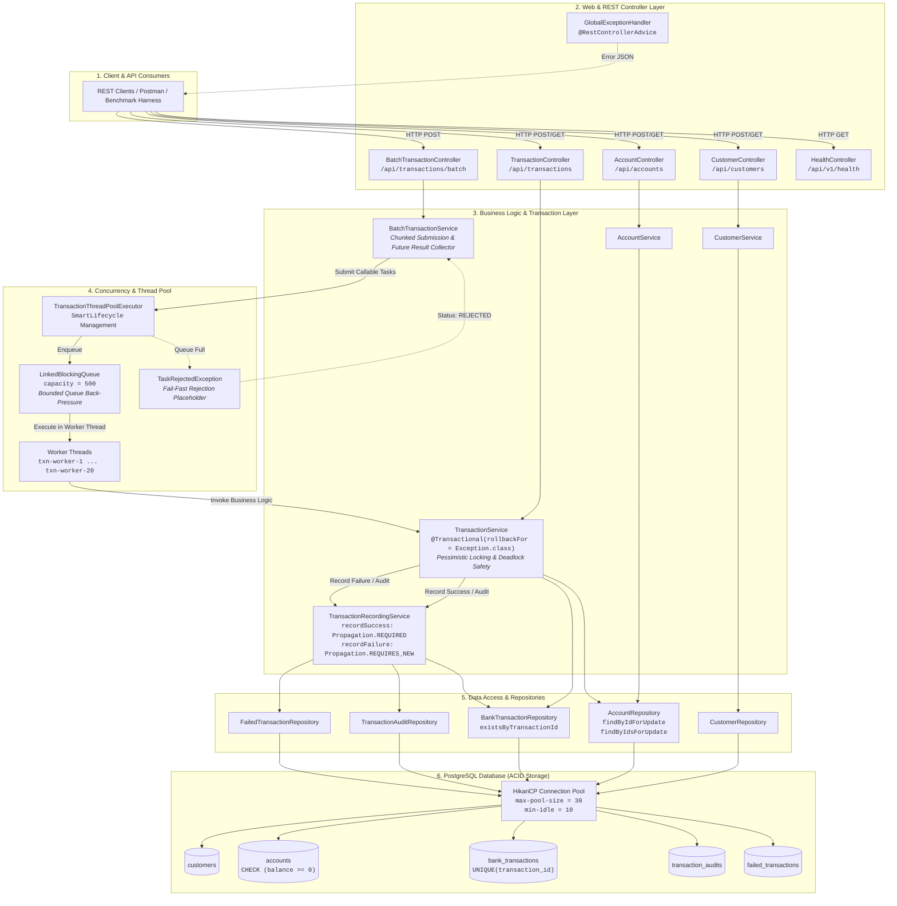
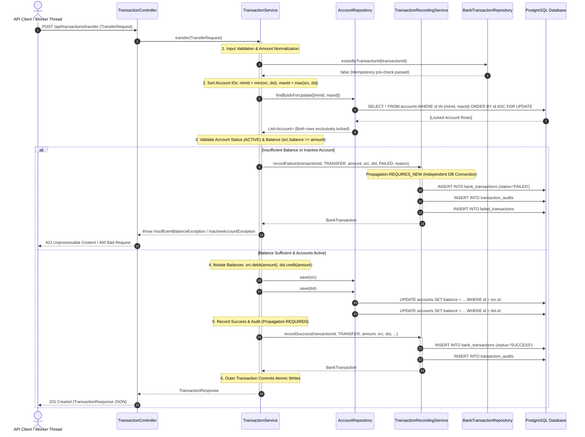
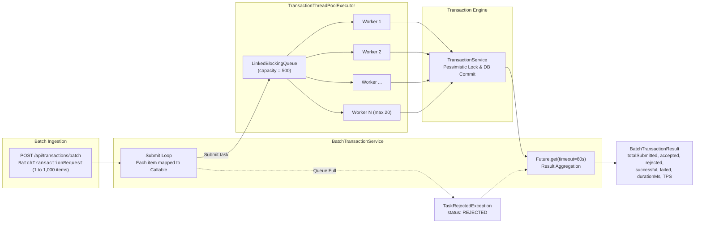

# System Architecture & Technical Flow

## 1. Overview

The **Multi-Threaded Banking Transaction Processing System** is built on a high-throughput, concurrency-safe, layered architecture designed with Spring Boot 4.2, Java 17, Spring Data JPA, and PostgreSQL. It delivers strict ACID guarantees, deadlock-free concurrent transaction processing, application- and database-level idempotency, and asynchronous batch execution via a custom bounded thread pool.

---

## 2. Layered Architecture Diagram

---

## 3. Core Transfer Request Flow with Pessimistic Locking

The diagram below illustrates the exact end-to-end flow of a fund transfer from Account A to Account B, highlighting the deterministic lock acquisition order that guarantees deadlock prevention.

---

## 4. Batch Transaction Processing Architecture

The batch transaction endpoint allows high-volume concurrent processing through controlled thread pool submission.

---

## 5. Architectural Quality Attributes

| Quality Attribute | Architectural Solution | Implementation Evidence |
|---|---|---|
| **Data Consistency & ACID** | Pessimistic locking (`SELECT ... FOR UPDATE`) before balance modification; strict non-negative check constraint. | `AccountRepository.findByIdForUpdate`, `002_create_accounts.sql` |
| **Deadlock Freedom** | Sorted account ID locking in transfers (`Math.min(srcId, dstId)` locked first). | `TransactionService.transfer()` lines 208–213 |
| **Idempotency** | Double-layer duplicate prevention: memory/query check (`existsByTransactionId`) + DB unique constraint (`uk_bank_transactions_transaction_id`). | `TransactionService.resolveUniqueTransactionId`, `TransactionRecordingService.saveBankTransaction` |
| **Auditability** | Every operation writes an immutable `transaction_audits` entry containing duration in milliseconds and executing worker thread name. | `TransactionRecordingService.saveAudit`, `transaction_audits` table |
| **Failure Durability** | Failed transactions are saved with categorized reasons (`INSUFFICIENT_BALANCE`, `INACTIVE_ACCOUNT`) using `Propagation.REQUIRES_NEW`, surviving outer rollback. | `TransactionRecordingService.recordFailure`, `failed_transactions` table |
| **High Concurrency & Back-Pressure** | Bounded `LinkedBlockingQueue` with graceful rejection via `TaskRejectedException`. | `TransactionThreadPoolExecutor.java`, `BatchTransactionService.java` |
| **Resource Efficiency** | Single connection reused for successful operations (`Propagation.REQUIRED`), eliminating Hikari connection pool deadlocks. | `TransactionRecordingService.recordSuccess`, Hikari pool max: 30 |
