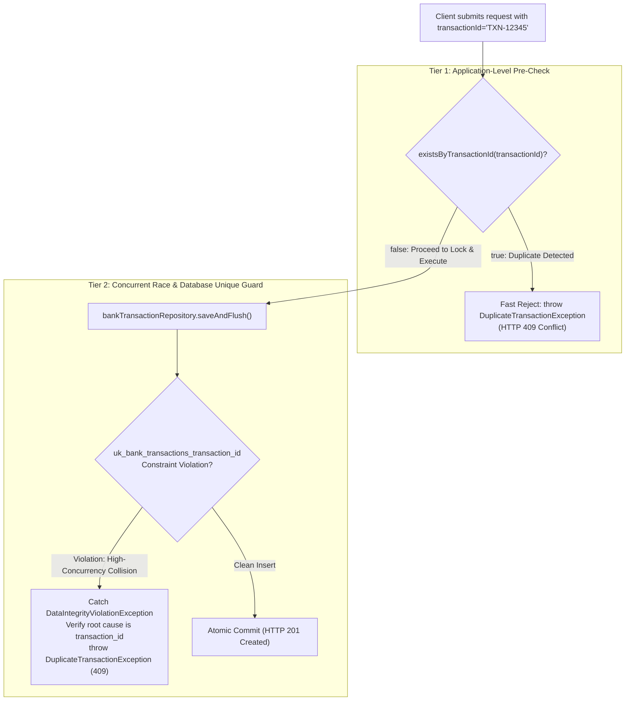

# Idempotency & Duplicate Transaction Protection Design

## 1. Overview

Network retries, client timeouts, and message replays are common in distributed banking architectures. If a client submits a ₹5,000 transfer and times out before receiving the HTTP response, re-sending the request must **never** process the ₹5,000 deduction a second time.

This document describes our two-tier idempotency architecture combining application-level fast-path rejection with database-level unique constraint enforcement.

---

## 2. Two-Tier Idempotency Architecture



---

## 3. Tier 1: Application-Level Duplicate Checking

In [TransactionService.java](file:///c:/Users/XPS/Documents/Newgen-Project/banking-transaction-system/backend/src/main/java/com/newgen\banking\service\TransactionService.java#L334-L353):

```java
private String resolveUniqueTransactionId(String rawTransactionId) {
    String transactionId;
    if (rawTransactionId == null) {
        transactionId = "TXN-" + UUID.randomUUID();
    } else {
        transactionId = rawTransactionId.trim();
        if (transactionId.isEmpty()) {
            throw new IllegalArgumentException("Transaction ID must not be blank");
        }
        if (transactionId.length() > 64) {
            throw new IllegalArgumentException("Transaction ID cannot exceed 64 characters");
        }
    }
    // Fast-path lookup
    if (bankTransactionRepository.existsByTransactionId(transactionId)) {
        throw new DuplicateTransactionException(
                "Duplicate transaction request rejected for transactionId: " + transactionId);
    }
    return transactionId;
}
```

- If no client transaction ID is provided, the system generates a cryptographically random UUID (`TXN-<UUID>`).
- If a client provides a transaction ID, the repository queries `existsByTransactionId(transactionId)`.
- If already present, it immediately rejects the request without acquiring row locks or accessing account data.

---

## 4. Tier 2: Database Unique Constraint & Race Translation

### 4.1 Database Constraint
*Source: `database/ddl/003_create_transactions.sql`*
```sql
CONSTRAINT uk_bank_transactions_transaction_id UNIQUE (transaction_id)
```

In high-concurrency scenarios, two requests with the identical transaction ID might pass the `existsByTransactionId()` check simultaneously before either has committed. The database unique constraint is the final authority.

### 4.2 Safe Exception Translation
When PostgreSQL raises a unique constraint violation, Spring wraps it in a `DataIntegrityViolationException`. In [TransactionRecordingService.java](file:///c:/Users/XPS/Documents/Newgen-Project/banking-transaction-system/backend/src/main/java/com/newgen/banking/service/TransactionRecordingService.java#L111-L125), we inspect the exception to distinguish duplicate IDs from unrelated database errors:

```java
private BankTransaction saveBankTransaction(BankTransaction tx) {
    try {
        return bankTransactionRepository.save(tx);
    } catch (DataIntegrityViolationException ex) {
        String msg = ex.getMessage() != null ? ex.getMessage().toLowerCase() : "";
        if (ex.getCause() != null && ex.getCause().getMessage() != null) {
            msg += " " + ex.getCause().getMessage().toLowerCase();
        }
        if (msg.contains("transaction_id") || msg.contains("uk_bank_transactions_transaction_id")) {
            throw new DuplicateTransactionException(
                    "Duplicate transaction request rejected for transactionId: " + tx.getTransactionId(), ex);
        }
        throw ex; // Re-throw unrelated violations (e.g. FK violations) as 500/DB errors
    }
}
```

- Genuine duplicate transaction ID collisions translate to `DuplicateTransactionException` $\to$ mapped to `409 Conflict`.
- Unrelated foreign key or check constraint violations are never misdiagnosed as duplicates.

---

## 5. Automated Test Evidence

In [TransactionConcurrencyTest.java](file:///c:/Users/XPS/Documents/Newgen-Project/banking-transaction-system/backend/src/test/java/com/newgen/banking/service/TransactionConcurrencyTest.java#L180-L205):

```java
@Test
@DisplayName("3 concurrent deposits with identical transactionId: exactly 1 succeeds")
void concurrentDuplicateTransactionIds_ShouldAllowOnlyOne() throws Exception {
    Long accountId = createAccountWithBalance("1000.00");
    String sharedTxId = "TXN-CONCURRENT-DUP-" + System.nanoTime();
    AtomicInteger successCount = new AtomicInteger(0);
    AtomicInteger rejectedCount = new AtomicInteger(0);

    runConcurrently(3, (i) -> {
        try {
            transactionService.deposit(
                    new DepositRequest(sharedTxId, accountId, new BigDecimal("100.00"), "dup test"));
            successCount.incrementAndGet();
        } catch (Exception ignored) {
            rejectedCount.incrementAndGet();
        }
    });

    assertEquals(1, successCount.get(), "Exactly one duplicate transaction should succeed");
    assertEquals(2, rejectedCount.get(), "The other 2 should be rejected");
    BigDecimal finalBalance = getBalance(accountId);
    assertEquals(0, new BigDecimal("1100.00").compareTo(finalBalance),
            "Only one deposit should have committed. Balance: " + finalBalance);
}
```
- **Test Result:** 3 threads attempt concurrent deposits with the exact same transaction ID.
- **Outcome:** Exactly 1 deposit commits (balance ₹1,100.00); the other 2 are rejected. Zero duplicate balance mutations.
