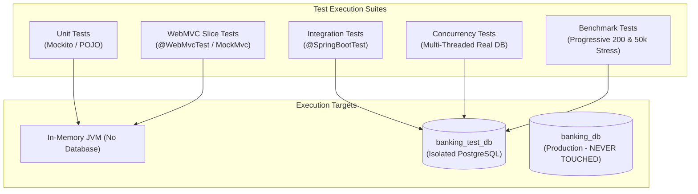

# Comprehensive Testing Strategy

## 1. Overview

Testing in a financial transaction system must prove not only that individual methods work in isolation, but that the entire system preserves ACID guarantees, prevents lost updates, eliminates deadlocks, and sustains high throughput under concurrent load.

Our test suite is organized into distinct, layered testing tiers:
1. Unit Tests
2. WebMVC Controller Slice Tests
3. PostgreSQL Integration Tests
4. Multi-Threaded Concurrency Tests
5. Progressive Performance Benchmarks (200 transactions)
6. High-Volume Stress Benchmarks (50,000+ transactions)

---

## 2. Test Architecture & Database Isolation



### 2.1 Complete Database Isolation
- **Production Database (`banking_db`):** Defined in `application.properties`. Never touched by automated tests.
- **Test Database (`banking_test_db`):** Configured in `application-test.properties` under `@ActiveProfiles("test")`. Schema DDLs (`001`, `002`, `003`) execute via Spring SQL initialization.
- **Deterministic Clean-up:** Integration tests use `@BeforeEach` and `@AfterEach` lifecycle hooks calling `deleteAllInBatch()` in foreign-key order (`transaction_audits` $\to$ `failed_transactions` $\to$ `bank_transactions` $\to$ `accounts` $\to$ `customers`), guaranteeing a clean slate before and after every test run.

---

## 3. Test Suites & Coverage Breakdown

### 3.1 Unit & WebMVC Slice Tests (83 Tests — 100% Passing)
Executed in seconds with no external database dependencies:

| Test Class | Focus Area | Test Count | Status |
|---|---|:---:|:---:|
| `CustomerServiceTest` | Customer registration, duplicate email validation, DTO mapping | 8 | PASSED |
| `AccountServiceTest` | Account creation, number generation sequence, balance checks | 11 | PASSED |
| `TransactionServiceTest` | Deposit, withdrawal, transfer business rules, duplicate detection | 11 | PASSED |
| `CustomerControllerTest` | REST endpoint validation, HTTP 201/400/404 response contracts | 8 | PASSED |
| `AccountControllerTest` | REST endpoint validation, HTTP 201/400/404 response contracts | 11 | PASSED |
| `TransactionControllerTest` | Core transaction endpoints, input validation, 201/400/409/422 | 13 | PASSED |
| `BatchTransactionControllerTest` | Batch validation, JSON contracts, payload size constraints | 8 | PASSED |
| `BatchTransactionServiceTest` | Concurrent execution logic, timeout, future handling, rejections | 7 | PASSED |
| `TransactionThreadPoolExecutorTest` | Pool lifecycle, queue capacity, rejection policy, shutdown | 17 | PASSED |

---

### 3.2 Multi-Threaded Concurrency Tests (`TransactionConcurrencyTest.java`)
Executes real concurrent threads against PostgreSQL:

1. **Concurrent Deposits (`concurrentDeposits_ShouldAllSucceedAndBalanceIsAccurate`):**
   - 10 threads deposit ₹100 simultaneously into an account with ₹1,000.
   - Verifies zero lost updates: final balance is exactly ₹2,000.00.
2. **Concurrent Withdrawals with Sufficient Funds (`concurrentWithdrawals_WithinBalance_ShouldAllSucceed`):**
   - 5 threads withdraw ₹100 simultaneously from an account with ₹1,000.
   - Verifies exact final balance ₹500.00.
3. **Simultaneous Overdraft Prevention (`concurrentWithdrawals_ExceedingBalance_OnlyOneSucceeds`):**
   - Account has ₹10,000.
   - Two concurrent threads attempt ₹7,000 and ₹5,000 withdrawals ($7,000 + 5,000 = 12,000 > 10,000$).
   - Verifies that exactly one withdrawal succeeds and the other fails with `InsufficientBalanceException`. Account balance is never negative.
4. **Duplicate Transaction ID Race (`concurrentDuplicateTransactionIds_ShouldAllowOnlyOne`):**
   - 3 concurrent threads submit the exact same transaction ID.
   - Verifies exactly 1 succeeds and 2 are rejected (HTTP 409).
5. **Opposite-Direction Transfer Deadlock Prevention (`oppositeDirectionTransfers_ShouldCompleteWithoutDeadlock`):**
   - Simultaneous transfers: Account A $\to$ B and Account B $\to$ A.
   - Verifies sorted ID locking eliminates circular wait deadlocks. Total money in system is conserved.
6. **Concurrent High-Contention Mixed Operations (`highContentionMixedOperations_BalanceRemainsConsistent`):**
   - 20 threads simultaneously deposit, withdraw, and transfer across accounts.
   - Verifies total funds conserved and non-negative balances.
7. **Multiple Independent Account Pairs (`independentAccountTransfers_CanRunInParallel`):**
   - Verifies parallelism when accounts do not conflict.
8. **Transfer Rolled Back on Insufficient Balance (`transferWithInsufficientBalance_RollsBackCompletely`):**
   - Verifies atomicity: when transfer fails, neither debit nor credit commits.
9. **Duplicate Transfer Request Rejected (`duplicateTransferRequest_IsRejected`):**
   - Verifies idempotency across transfer operations.

---

### 3.3 Performance & Stress Benchmarks
- **Progressive Benchmarks (`TransactionBenchmarkTest.java`):**
  - Runs 200 transactions across 1, 5, 10, and 20 worker threads.
  - Verifies throughput (TPS), duration in milliseconds, and HikariCP connection pool metrics.
- **50,000+ Transaction Stress Benchmark (`StressBenchmark50kTest.java`):**
  - Submits 50,000 mixed transactions in 100 chunked batches of 500 across 10 active accounts.
  - Verifies exact balance conservation, audit persistence, and failure categorization at scale.

---

## 4. How to Execute Test Suites

### Running Fast Unit & MockMvc Tests
```powershell
cd banking-transaction-system\backend
.\mvnw.cmd test "-Dtest=BatchTransactionServiceTest,TransactionThreadPoolExecutorTest,BatchTransactionControllerTest,CustomerServiceTest,AccountServiceTest,TransactionServiceTest,CustomerControllerTest,AccountControllerTest,TransactionControllerTest"
```

### Running Concurrency Tests (Requires Local PostgreSQL)
```powershell
$env:TEST_DB_PASSWORD="your_postgres_password"
cd banking-transaction-system\backend
.\mvnw.cmd test "-Dtest=TransactionConcurrencyTest"
```

### Running Progressive Benchmarks
```powershell
$env:TEST_DB_PASSWORD="your_postgres_password"
cd banking-transaction-system\backend
.\mvnw.cmd test "-Dtest=TransactionBenchmarkTest#benchmark_1Worker_200Transfers"
.\mvnw.cmd test "-Dtest=TransactionBenchmarkTest#benchmark_5Workers_200Transfers"
.\mvnw.cmd test "-Dtest=TransactionBenchmarkTest#benchmark_10Workers_200Transfers"
.\mvnw.cmd test "-Dtest=TransactionBenchmarkTest#benchmark_20Workers_200Transfers"
```

### Running 50,000-Transaction Stress Benchmark
```powershell
$env:TEST_DB_PASSWORD="your_postgres_password"
cd banking-transaction-system\backend
.\mvnw.cmd test "-Dtest=StressBenchmark50kTest#benchmark50k_10Workers"
```
