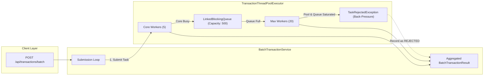

# Thread Pool & Concurrent Batch Processing Design

## 1. Overview

The **Multi-Threaded Banking Transaction Processing System** features a custom bounded thread pool executor ([TransactionThreadPoolExecutor.java](file:///c:/Users/XPS/Documents/Newgen-Project/banking-transaction-system/backend/src/main/java/com/newgen/banking/executor/TransactionThreadPoolExecutor.java)) and a batch transaction processing service ([BatchTransactionService.java](file:///c:/Users/XPS/Documents/Newgen-Project/banking-transaction-system/backend/src/main/java/com/newgen/banking/service/BatchTransactionService.java)). This allows clients to submit batches of up to 1,000 transactions concurrently, achieving high throughput while enforcing back-pressure and protecting JVM memory and database connection limits.

---

## 2. Bounded Queue Architecture & Back-Pressure



### 2.1 Why Bounded Queues (Capacity = 500)?
An unbounded queue (`new LinkedBlockingQueue<>()`) grows without limit when incoming request rates exceed database processing speeds. This leads to:
1. **Memory Exhaustion (OOM):** Heap overflows from accumulating millions of queued tasks.
2. **Latency Inflation:** Requests sit in memory for minutes; by the time they run, the client has timed out.
3. **No Back-Pressure:** The producer receives no signal to throttle.

With a bounded capacity of 500:
- When workers and queue are full, `RejectedExecutionHandler` throws `TaskRejectedException`.
- The batch service catches this and marks the item status as `REJECTED`, returning immediately to the client with clear saturation indicators.

### 2.2 Controlled In-Flight Sliding Window (Bounded Backpressure)
When a valid batch contains up to 1,000 transactions, submitting all 1,000 tasks in a tight unpaced loop would immediately saturate a bounded queue (e.g., test capacity of 100 or production capacity of 500), causing self-rejection of valid tasks.

To prevent self-saturation while strictly preserving bounded queues:
- `BatchTransactionService` implements a **controlled sliding window** where in-flight tasks submitted to the executor are capped at:
  $$\text{maxInFlight} = \min\left(\max\left(1, \frac{\text{queueCapacity}}{2}\right), 100\right)$$
- As tasks complete, completed futures are eagerly reaped via `.isDone()`.
- If the active in-flight count reaches `maxInFlight`, the producer waits on the oldest in-flight task before offering more work to the executor.
- This guarantees:
  1. Valid 1,000-transaction batches process continuously without self-induced queue overflow.
  2. The queue always maintains at least 50% headroom for external requests.
  3. If external load genuinely exhausts the queue, `TaskRejectedException` is cleanly captured as `TransactionStatus.REJECTED`.
  4. Every accepted task is guaranteed to complete before `processBatch` returns.

---

## 3. Configuration & Tuning Parameters

All thread pool settings are externalized in `application.properties`:

| Property | Default | Test Profile | Purpose |
|---|:---:|:---:|---|
| `banking.executor.core-pool-size` | `5` | `4` | Worker threads kept alive permanently. |
| `banking.executor.max-pool-size` | `20` | `8` | Maximum burst worker threads spun up when queue is full. |
| `banking.executor.queue-capacity` | `500` | `100` | Bounded capacity before tasks trigger back-pressure. |
| `banking.executor.keep-alive-seconds` | `60` | `10` | Expiry time for idle non-core worker threads. |
| `banking.executor.shutdown-timeout-seconds` | `30` | `10` | Graceful drain timeout during application shutdown. |
| `banking.executor.thread-name-prefix` | `txn-worker-` | `test-txn-worker-` | Prefix for thread inspection in logs and thread dumps. |

---

## 4. Lifecycle Management (`SmartLifecycle`)

Instead of standard `@PreDestroy`, `TransactionThreadPoolExecutor` implements Spring's `SmartLifecycle`:
- **`start()`:** Initializes the `ThreadPoolExecutor`, custom `ThreadFactory`, and `LinkedBlockingQueue` when the Spring Application Context finishes starting.
- **`stop()`:** Invoked on SIGTERM or context closure. Initiates `executor.shutdown()` and blocks up to `shutdownTimeoutSeconds` (30s) allowing in-flight banking transactions to complete and commit before forcing `executor.shutdownNow()`.
- **Guarantee:** No in-flight banking transaction is killed mid-mutation during application restarts.

---

## 5. Dual Propagation in Transaction Recording

During Day 5/6 benchmarking, we optimized the database transaction scope:
- **`recordSuccess()` (`Propagation.REQUIRED`):** Commits the balance update, `bank_transactions` record, and `transaction_audits` entry on the **same database connection**. This eliminated connection pool deadlocks by dropping connection requirements to 1 per worker thread.
- **`recordFailure()` (`Propagation.REQUIRES_NEW`):** Borrows an independent connection so that failure reasons (`INSUFFICIENT_BALANCE`, `INACTIVE_ACCOUNT`) persist permanently even when the outer transaction rolls back.

---

## 6. Batch Endpoint Usage & Performance Verification

Clients submit up to 1,000 transactions to `POST /api/transactions/batch`:

```json
{
  "batchId": "BATCH-20261128-01",
  "transactions": [
    {
      "transactionId": "TXN-B01-001",
      "type": "DEPOSIT",
      "destinationAccountId": 1,
      "amount": 100.00,
      "description": "Salary deposit"
    },
    {
      "transactionId": "TXN-B01-002",
      "type": "TRANSFER",
      "sourceAccountId": 1,
      "destinationAccountId": 2,
      "amount": 50.00,
      "description": "Savings transfer"
    }
  ]
}
```

The service processes tasks concurrently across worker threads and returns full execution metrics:
- `totalSubmitted`: Total tasks in request
- `accepted`: Tasks accepted into queue
- `rejected`: Tasks rejected due to queue saturation
- `successful`: Transactions committed with `SUCCESS`
- `failed`: Transactions completed with business `FAILED` status
- `durationMs`: Wall-clock processing time
- `tps`: Throughput in Transactions Per Second
