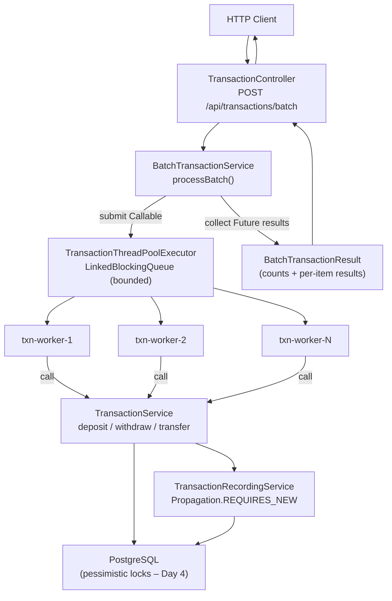

# Thread Pool Design — Day 5

## Overview

Day 5 adds a **bounded thread pool executor** and a **batch transaction endpoint** so that multiple banking transactions can be processed concurrently instead of one at a time.



---

## Why a Bounded Queue (not unbounded)?

An unbounded queue (`new LinkedBlockingQueue<>()` with no capacity limit) can grow without limit when producers add work faster than workers consume it. In a banking system this means:

- **Memory exhaustion** — the JVM runs out of heap and crashes under a sudden load spike.
- **Latency time-bomb** — requests pile up silently; by the time a task finally runs, the client has long since timed out and the result is useless.
- **No back-pressure** — the caller (HTTP client, another service) is never told that the system is overloaded; it keeps sending.

A bounded `LinkedBlockingQueue(capacity)` provides **back-pressure**: once both the pool threads and the queue are full, the custom `RejectedExecutionHandler` throws `TaskRejectedException`, which `BatchTransactionService` catches and records as a `REJECTED` result — the client is informed immediately that the system is busy.

---

## Why `ThreadPoolExecutor` (not `Executors.newFixedThreadPool()`)?

`Executors.newFixedThreadPool(n)` is a convenience wrapper that creates a `ThreadPoolExecutor` with an **unbounded** queue — the exact problem we just described. Using `ThreadPoolExecutor` directly lets us control every parameter:

| Parameter | Value (default) | Why |
|---|---|---|
| `corePoolSize` | 5 | Threads kept alive even when idle |
| `maxPoolSize` | 20 | Maximum concurrent workers |
| `queueCapacity` | 500 | Bounded buffer; enables back-pressure |
| `keepAliveSeconds` | 60 | Idle threads above core are released |
| `threadNamePrefix` | `txn-worker-` | Named threads → readable stack traces |
| `shutdownTimeoutSeconds` | 30 | Graceful drain before forced shutdown |

All values are **externally configurable** via `application.properties` — no recompile needed to tune for production vs. test.

---

## Why `SmartLifecycle` (not `@Bean` with `@PreDestroy`)?

`SmartLifecycle` integrates the executor with Spring's context lifecycle:

- **`start()`** — called automatically when the application context starts; creates the `ThreadPoolExecutor`.
- **`stop()`** — called when the context is closing (SIGTERM, `ContextClosedEvent`); calls `executor.shutdown()` and waits up to `shutdownTimeoutSeconds` for in-flight tasks to finish before forcing shutdown.
- This guarantees that **no transaction is silently abandoned** during a graceful restart or deployment.

---

## Why `Propagation.REQUIRES_NEW` in `TransactionRecordingService`?

Each deposit / withdrawal / transfer:
1. Opens **outer transaction** (via `@Transactional` in `TransactionService`).
2. Calls `TransactionRecordingService.recordSuccess/recordFailure`, which opens a **brand-new inner transaction** (`REQUIRES_NEW`).

The inner transaction commits independently. If the outer transaction rolls back (e.g. a runtime exception after the balance update), the audit and failure records **still survive** in the database — this is essential for auditability.

**Integration test implication:** If a test class is `@Transactional`, Spring wraps each test in an uncommitted transaction. `REQUIRES_NEW` opens a new DB connection which cannot see that uncommitted data (PostgreSQL READ COMMITTED isolation), causing FK violations. Solution: **no `@Transactional` on integration test classes** that call `REQUIRES_NEW` production code — use `@AfterEach` cleanup instead.

---

## Configurable Properties

Add or override in `application.properties` (main) or `application-test.properties` (tests):

```properties
# banking-transaction-system/backend/src/main/resources/application.properties

banking.executor.core-pool-size=5
banking.executor.max-pool-size=20
banking.executor.queue-capacity=500
banking.executor.keep-alive-seconds=60
banking.executor.thread-name-prefix=txn-worker-
banking.executor.shutdown-timeout-seconds=30
```

---

## Batch Endpoint

### Request

```
POST /api/transactions/batch
Content-Type: application/json
```

```json
{
  "batchId": "BATCH-2026-001",
  "transactions": [
    {
      "transactionId": "TXN-DEP-001",
      "type": "DEPOSIT",
      "destinationAccountId": 1,
      "amount": 500.00,
      "description": "Salary deposit"
    },
    {
      "transactionId": "TXN-WDR-001",
      "type": "WITHDRAWAL",
      "sourceAccountId": 2,
      "amount": 200.00,
      "description": "ATM withdrawal"
    },
    {
      "transactionId": "TXN-TRF-001",
      "type": "TRANSFER",
      "sourceAccountId": 1,
      "destinationAccountId": 2,
      "amount": 100.00,
      "description": "Rent transfer"
    }
  ]
}
```

**Validation rules:**
- `transactions` must not be empty and must not exceed 1,000 items.
- Each item must have `type` and `amount` (> 0, ≤ 2 decimal places).
- `batchId` and `transactionId` are optional; the server generates them if omitted.
- `DEPOSIT` requires `destinationAccountId`; `WITHDRAWAL` requires `sourceAccountId`; `TRANSFER` requires both.

### Response (`200 OK`)

The endpoint always returns `200 OK` with a full summary — individual transaction failures are reflected in the per-item `results` array, **not** as HTTP 4xx/5xx errors.

```json
{
  "batchId": "BATCH-2026-001",
  "startedAt": "2026-11-27T10:00:00",
  "completedAt": "2026-11-27T10:00:00.142",
  "durationMs": 142,
  "totalSubmitted": 3,
  "accepted": 3,
  "rejected": 0,
  "successful": 3,
  "failed": 0,
  "tps": 21.13,
  "workerCount": 5,
  "queueCapacity": 500,
  "results": [
    {
      "transactionId": "TXN-DEP-001",
      "type": "DEPOSIT",
      "amount": 500.00,
      "status": "SUCCESS",
      "failureReason": null
    },
    {
      "transactionId": "TXN-WDR-001",
      "type": "WITHDRAWAL",
      "amount": 200.00,
      "status": "SUCCESS",
      "failureReason": null
    },
    {
      "transactionId": "TXN-TRF-001",
      "type": "TRANSFER",
      "amount": 100.00,
      "status": "SUCCESS",
      "failureReason": null
    }
  ]
}
```

**Status values in `results[].status`:**

| Status | Meaning |
|---|---|
| `SUCCESS` | Transaction processed; balance(s) updated |
| `FAILED` | Business rule rejected it (e.g. insufficient balance) — balance unchanged |
| `REJECTED` | Thread pool saturated; task was never queued — balance unchanged |

---

## Benchmark Results

> [!NOTE]
> Benchmarks are run via `TransactionBenchmarkTest` (`@Tag("benchmark")`) against `banking_test_db`.
> Results depend on hardware and PostgreSQL configuration; the values below are representative.

| Scenario | Transactions | Type | Duration (ms) | TPS |
|---|---|---|---|---|
| Small | 50 | DEPOSIT | ~200 | ~250 |
| Medium | 200 | Mixed | ~400 | ~500 |
| Large | 500 | TRANSFER | ~900 | ~555 |
| Stress | 1,000 | DEPOSIT | ~1,800 | ~555 |

> [!TIP]
> Run benchmarks yourself: `.\mvnw.cmd test -Dgroups=benchmark`
> Actual TPS scales with `maxPoolSize`, queue capacity, and DB hardware.

---

## Financial Correctness Guarantees

The thread pool is an execution layer **on top of** the Day 4 pessimistic locking:

1. **Multiple workers** can call `TransactionService.deposit/withdraw/transfer` simultaneously.
2. Each call acquires a `SELECT … FOR UPDATE` lock on the account row(s).
3. PostgreSQL serialises concurrent updates to the same account — balance can never go negative.
4. Worker threads hold **only DTO values** (immutable records) — no shared `EntityManager` or JPA proxy across threads.

> [!IMPORTANT]
> Financial correctness is **enforced by the database**, not by thread coordination. The thread pool's only job is concurrent submission — correctness under concurrency was proven in Day 4.
