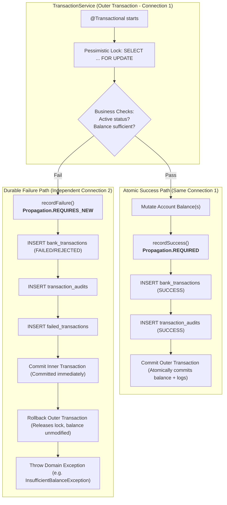

# Transaction Management & ACID Boundary Design

## 1. Overview

In financial transaction processing, data consistency is non-negotiable. Every deposit, withdrawal, and transfer must satisfy strict ACID properties (Atomicity, Consistency, Isolation, Durability). This document details how Spring's declarative transaction management (`@Transactional`) is architected with PostgreSQL, explaining transaction boundaries, Spring propagation policies, and the failure persistence strategy.

---

## 2. Transaction Boundaries

### 2.1 The Business Transaction Boundary
In [TransactionService.java](file:///c:/Users/XPS/Documents/Newgen-Project/banking-transaction-system/backend/src/main/java/com/newgen/banking/service/TransactionService.java), each mutating operation (`deposit`, `withdraw`, `transfer`) defines the outer transaction boundary:

```java
@Transactional(rollbackFor = Exception.class)
public TransactionResponse transfer(TransferRequest request) { ... }
```

- **Rollback Guarantee:** Configured with `rollbackFor = Exception.class` so both unchecked runtime exceptions (`InsufficientBalanceException`, `InactiveAccountException`, `DuplicateTransactionException`) and any checked exceptions trigger a transaction rollback.
- **Connection Scope:** HikariCP leases one database connection for the lifespan of this `@Transactional` invocation.

---

## 3. Transaction Propagation Strategy

A critical design challenge in banking systems is: **If a business operation fails (e.g. overdraft or account frozen) and its database changes roll back, how do we record the failed transaction and audit trail?**

If failure logging runs in the same transaction, the rollback will also wipe the audit log!

### 3.1 Dual Propagation Architecture

We resolve this through a dedicated service: [TransactionRecordingService.java](file:///c:/Users/XPS/Documents/Newgen-Project/banking-transaction-system/backend/src/main/java/com/newgen/banking/service/TransactionRecordingService.java).



### 3.2 Propagation Breakdown

| Operation | Propagation | Rationale & Connection Behavior |
|---|---|---|
| **`recordSuccess()`** | `Propagation.REQUIRED` | Participates in the caller's active transaction. Account balance mutations and `BankTransaction` / `TransactionAudit` records **commit atomically on a single database connection**. If an unexpected error occurs during insert, the balance mutation rolls back too, ensuring balance and history never diverge. Reusing Connection 1 also prevents HikariCP connection pool starvation. |
| **`recordFailure()`** | `Propagation.REQUIRES_NEW` | Suspends the caller's transaction and borrows an independent connection to commit the `bank_transactions`, `transaction_audits`, and `failed_transactions` rows immediately. When the outer transaction subsequently rolls back, the failure record remains durably stored in the database. |

---

## 4. Atomic Multi-Leg Fund Transfers

A fund transfer is a two-legged financial transaction involving both a source account debit and a destination account credit:

$$\Delta \text{Balance}_{\text{src}} = -\text{amount}, \quad \Delta \text{Balance}_{\text{dst}} = +\text{amount}$$

$$\sum \Delta \text{Balance} = 0 \quad (\text{Conservation of Money})$$

### 4.1 Step-by-Step Transaction Lifecycle in `transfer()`
1. **Idempotency Check:** Fast lookup via `existsByTransactionId()`.
2. **Deterministic Locking Order:** Sorts IDs `minId = Math.min(src, dst)` and `maxId = Math.max(src, dst)`. Locks both rows via `findByIdsForUpdate([minId, maxId])`.
3. **State & Balance Validation:** Asserts both accounts are `ACTIVE`. Asserts `source.balance >= amount`.
4. **In-Memory Balance Mutation:** `source.setBalance(source.getBalance().subtract(amount))` and `destination.setBalance(destination.getBalance().add(amount))`.
5. **Persistence Flushes:** Saves both mutated accounts.
6. **Audit & Transaction Record:** Invokes `recorder.recordSuccess(...)`.
7. **Commit:** Outer transaction commits, atomically writing both account balance changes, the `bank_transactions` record, and the `transaction_audits` entry, and releasing both row locks.

---

## 5. Integration Test Transaction Boundary Isolation

In Spring integration testing (`@SpringBootTest`), test methods are often annotated `@Transactional` so changes automatically roll back after each test. 

**Why we do NOT use `@Transactional` on integration test classes:**
When a test method is annotated `@Transactional`, its test fixtures are uncommitted in Connection 1. When `recordFailure()` executes with `Propagation.REQUIRES_NEW`, it opens Connection 2. Because PostgreSQL uses `READ COMMITTED` transaction isolation, Connection 2 cannot see the uncommitted account created by Connection 1, causing a foreign key violation (`SQLState 23503`).

**Solution:**
- We keep test classes free of `@Transactional`.
- We use `@BeforeEach` and `@AfterEach` lifecycle hooks calling `deleteAllInBatch()` in foreign-key order.
- Each test runs against committed data and cleans up deterministically.
